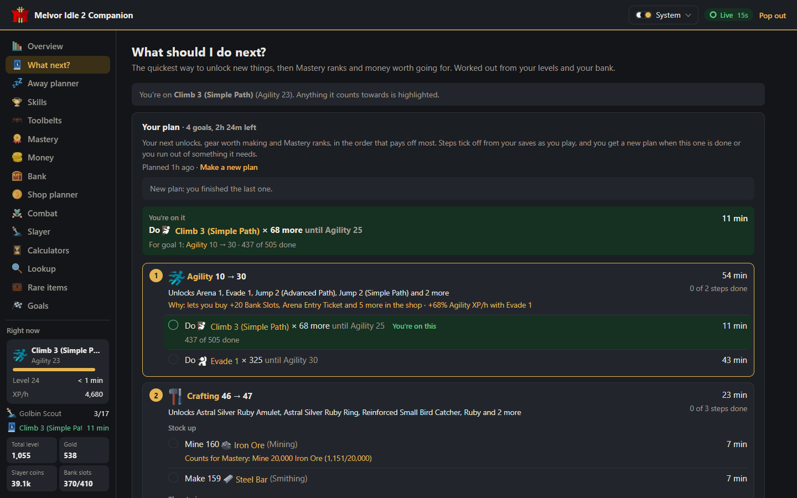
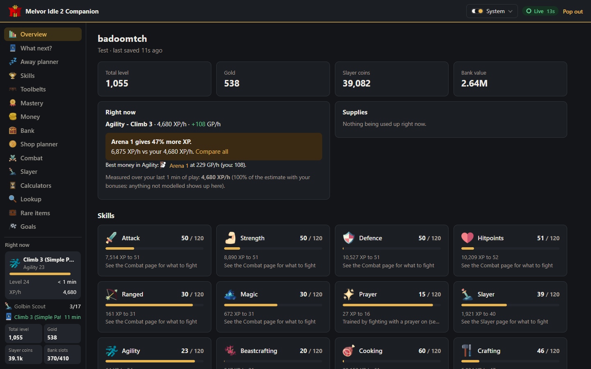
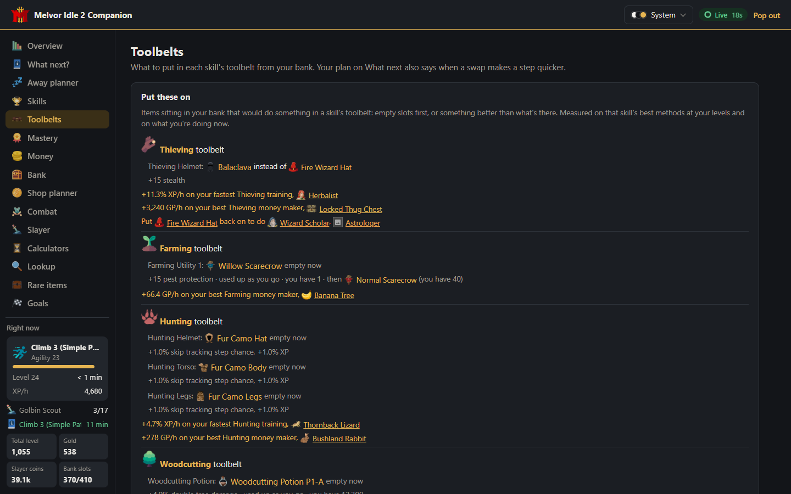
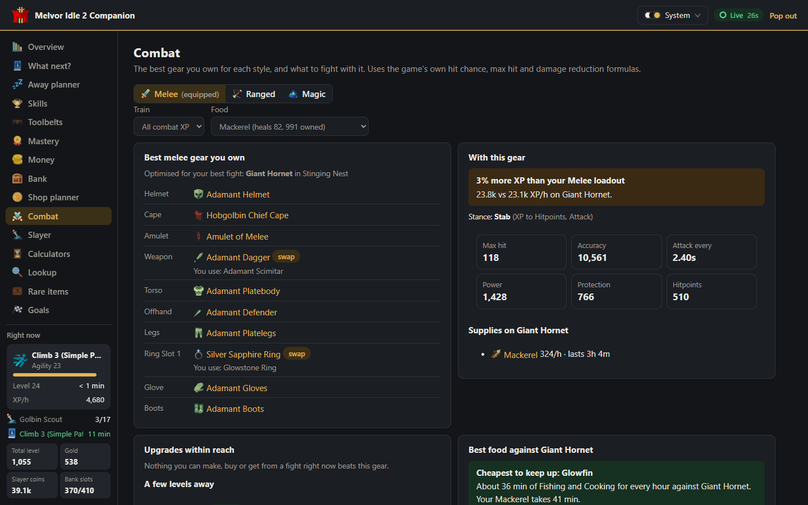
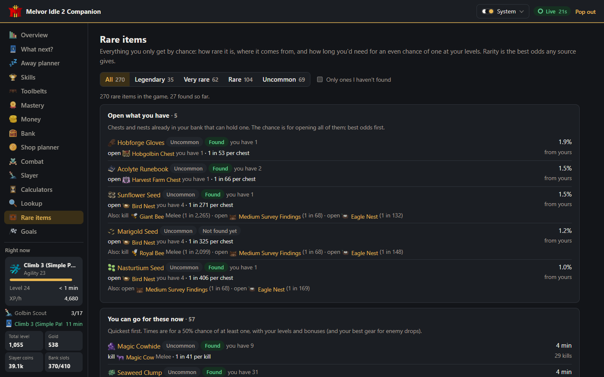
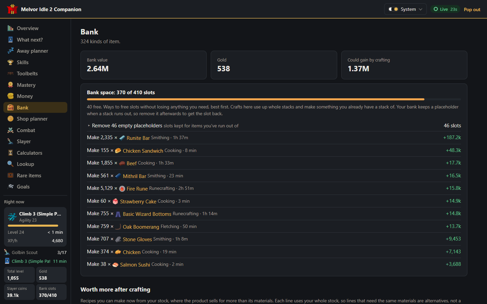
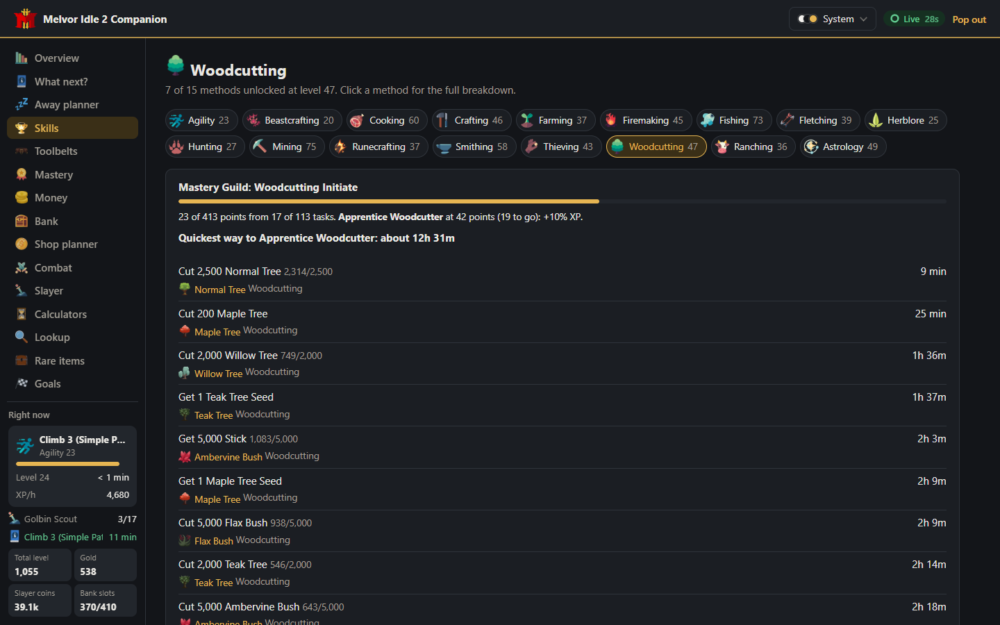
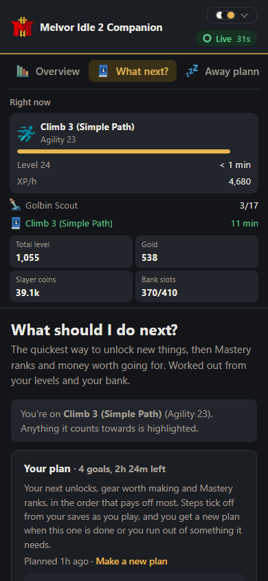

# Melvor Idle 2 Companion

A free helper that runs alongside Melvor Idle 2. It reads your save every time the game autosaves and tells you the best thing to do next: what to train, what to make, what to fight, what to put on and what to sell.

It runs on your own computer as a small web page. There's no account, no sign-in and nothing to install.

## What it does for you

**Gives you a plan.** What next lists your next goals in the order that pays off most: the next unlock in each skill, gear worth making, and Mastery Guild ranks. Each goal has concrete steps, such as "Mine 160 Iron Ore", then "Make 159 Steel Bar", then "Train until Crafting 47", with how long each takes. Steps tick off by themselves as you play. When the plan is done or you run out of something, you get a new one.

**Tells you when you could be doing better.** It grades what you're doing against everything you've unlocked ("Willow Tree gives 70% more XP"), and shows your real XP per hour measured from your saves.

**Uses what you already own.** Plans start from your bank. The Toolbelts page and your plan point out tools and potions sitting in your bank that would make something quicker ("Put on Balaclava instead of Fire Wizard Hat: 13% faster"). The Combat page picks the best gear you own for each style.

**Answers the questions you'd otherwise look up:**
- **Combat:** which enemy gives the most XP or GP per hour with your gear, how likely it is to kill you, what food lasts longest, and which upgrades are within reach.
- **Slayer and dungeons:** whether to keep or reroll a task, and what each dungeon run is worth.
- **Money:** the best money makers after the cost of materials and food, crafts worth more than their materials, and items that are safe to sell.
- **Shop planner:** which upgrades pay for themselves fastest, and whether to buy or make each shop item.
- **Rare items:** everything you only get by chance, how rare it is, where to get it, and how long you'd need for a good chance at your levels.
- **Bank:** how full it is, and the easiest ways to free slots without losing anything you need.
- **Away planner:** the best thing to leave running while you're away, up to the game's 24-hour offline limit.
- **Lookup:** where any item comes from, what uses it and what it's worth.

**Keeps an eye on things.** It can warn you before food, ammo or materials run out, when nothing is training, and when a step of your plan is done. Warnings can arrive as desktop notifications even with the page closed. The Pop out button gives you a small always-on-top window with what you're doing and what's next.

## Screenshots

| | |
| --- | --- |
|  |  |
| Overview: every skill at a glance, what you're doing now and what runs out first | Toolbelts: items in your bank worth putting on, and what each one gives |
|  |  |
| Combat: the best gear you own and what to fight with it | Rare items: where to get them and how long it takes |
|  |  |
| Bank: value, space and the easiest slots to free | A skill: every method, and the quickest Mastery Guild tasks |

It also fits a narrow window, so you can keep it next to the game:

## Download and run

### Windows

1. Download **`MelvorIdle2Companion.exe`** from the [latest release](https://github.com/badoomtch/melvor-idle-2-companion/releases/latest).
2. Double-click it. The first time, Windows may say "Windows protected your PC" because the program isn't signed. Click **More info**, then **Run anyway**.
3. Your browser opens the companion. Start Melvor Idle 2 and the page fills in within a few seconds, then keeps up with every autosave.

To stop it, close the black console window.

### macOS and Linux, or running from source

1. Install [Node.js](https://nodejs.org) (the LTS version).
2. Download or clone this repository.
3. Run `./start-companion.sh` (macOS or Linux) or double-click `MelvorCompanion.bat` (Windows). The page opens at <http://127.0.0.1:47820>.

### Where it finds your save

It looks in the game's own save folder and checks every Steam account on the computer:

| System | Folder |
| --- | --- |
| Windows | `%APPDATA%\Games By Malcs\Melvor Idle 2\` |
| macOS | `~/Library/Application Support/Games By Malcs/Melvor Idle 2/` |
| Linux | `~/.local/share/Games By Malcs/Melvor Idle 2/` |

No save yet? Go to **Settings** and choose **Enter by hand** to type in your levels and use the planner anyway.

## Updates

When there's a new version, the companion shows a note at the top of the page with a link to download it. It checks GitHub every few hours. You can turn this off in **Settings → About**.

When the game itself updates, the companion keeps working. If a new game version changes its save format, the companion tells you its numbers may be off until it's updated.

## Is it safe?

- **Your save is only ever read, never changed.** Reading takes a millisecond and can't get in the way of the game's autosave.
- **Nothing about your game leaves your computer.** The page is only reachable from your own computer. The one thing the companion asks the internet is whether there's a newer version on GitHub, and you can turn that off.
- Your goals and settings stay on your computer.

## How accurate is it?

Rates follow the game's own formulas: action times, success chances, drop tables, the XP curve and the combat formulas. They include your shop upgrades, toolbelt items, pets, set bonuses, Mastery Guild ranks and, in combat, your gear and prayers.

The **Accuracy** page compares the companion's estimates with what each action really gave you between autosaves. Your plan uses those measurements, so its times reflect how fast you actually play.

A few things aren't counted yet, so treat these numbers as rough:
- Your weapon's special attacks.
- Bonuses from your selected food.
- Effects from enemy special attacks, such as bleed and burn.
- Bonfires and Aurora events.

See [CHANGELOG.md](CHANGELOG.md) for what changed in each version.

## Feedback

Found advice that doesn't match the game? [Open an issue](https://github.com/badoomtch/melvor-idle-2-companion/issues) with a screenshot of the page and what you expected. Settings has a **Save my stats file** button that writes your levels and the companion's estimate-vs-real numbers to a file (no character name), which helps a lot.

## Building it yourself

See [docs/DEVELOPING.md](docs/DEVELOPING.md) for running from source, rebuilding the game data after a game update, building the exe and making a release.
